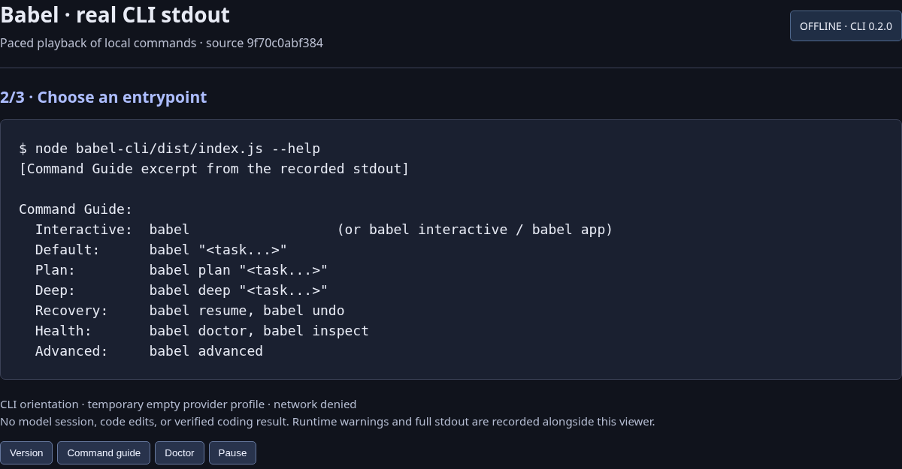
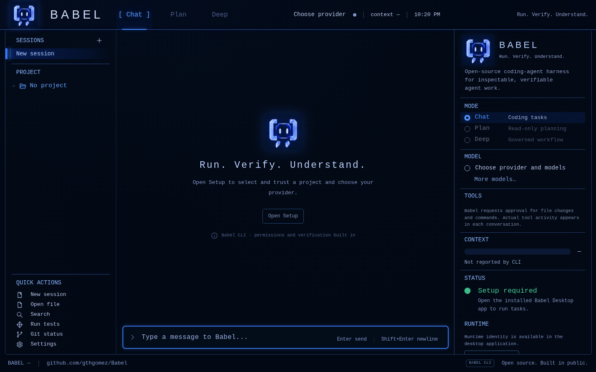
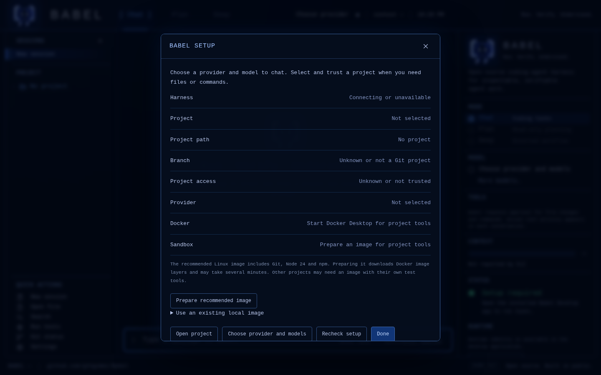

# Babel

[](https://github.com/gthgomez/Babel/releases/latest)
[](./LICENSE)
[](https://github.com/gthgomez/Babel/actions)

**Babel is an open-source coding agent for your repositories.** Use Chat for day-to-day tasks, Plan when you want to review a proposal first, or Deep for a more structured workflow. Babel makes its instructions, permissions, tool activity, and verification evidence visible as it works.

Babel is pre-1.0 and still being qualified for ordinary coding work. Provider setup and repository execution requirements vary; a saved key or selected model does not confirm provider access. See [project status](docs/STATUS.md) for current evidence and limits.

## What you can do

| Mode | Good for |
| --- | --- |
| **Chat** | Investigate a repository, ask questions, and work through coding tasks |
| **Plan** | Review a proposed approach before asking Babel to make changes |
| **Deep** | Follow a more structured workflow for riskier work; this is not a reliability upgrade by itself |

Babel also provides command-line runs, a read-only MCP control surface, inspectable prompt stacks, configurable execution profiles, checkpoints, diagnostics, and recovery tools such as `undo`. File changes and commands follow the active permissions and execution profile. Verification applies to declared or inferred checks; it is not a guarantee for every task.

## See Babel

### CLI



[Watch the 18-second CLI walkthrough](docs/assets/showcase/offline-cli.mp4) · [Animated preview](docs/assets/showcase/offline-cli.gif)

This capture shows real `--version`, `--help`, and environment-diagnostics output from Babel CLI 0.2.0. It uses an empty provider profile and makes no model request. The missing-provider warning is expected. It demonstrates local setup commands, not a completed coding task or model-backed reliability. See [capture details](docs/assets/showcase/README.md).

## Install with npm

The CLI is the quickest way to try Babel. It runs on **Node.js 22.19.0+ in the 22.x line or 24.13.1+ in the 24.x line**. The current npm release is `babel-harness@0.2.0`. The current source has a newer default-model snapshot than this npm release; use the published package as it is.

```sh
npm install --global babel-harness@0.2.0
babel-harness --version
babel-harness setup
babel-harness doctor
```

`setup` lists the first steps; `doctor` reports what is configured on your machine. Before model-backed work, configure a supported provider key in your private Babel profile (`~/.babel/config/.env`, or `%USERPROFILE%/.babel/config/.env` on Windows). For example, if you use OpenRouter:

```dotenv
OPENROUTER_API_KEY=your-key
```

Keep the key out of your project and source checkout. Babel's diagnostics do not send provider requests. A saved key does not confirm that the provider accepts it.

For project tasks, the default `safe_repo` profile requires Docker and a usable project-tools image. `doctor` reports whether these are ready; it does not silently fall back to running project commands on your host. Desktop Setup can prepare the recommended image. See [execution profiles](docs/CLI_QUICKSTART.md#execution-profile-read-this-before-the-first-edit) for details.

Once your provider and execution setup are ready, start Babel from the repository you want to work in:

```sh
cd /path/to/your/repository
babel-harness interactive
```

Then describe the task you want help with. Babel selects the nearest recognized project at or above the current directory; check the displayed target before you continue. For a bounded first request, ask Babel to trace a documented behavior and its nearest test without changing files.

## Babel Desktop

Babel Desktop provides a Windows interface for the Babel CLI. The only downloadable desktop build is **Windows x64 0.1.3**. Get the [Setup installer or portable ZIP](https://github.com/gthgomez/Babel/releases/tag/v0.1.3); both include the CLI. The app is unsigned, and Windows may show a SmartScreen warning. The [release-pinned setup guide](https://github.com/gthgomez/Babel/blob/v0.1.3/babel-desktop/docs/INSTALL-WINDOWS.md) covers checksums and installation. Desktop is not currently published as an npm package, and the 0.1.3 app bundles its own CLI, so it does not include every change in the newer npm release.

The images and video below are a **browser-rendered preview of the current source interface**. They show the real renderer and setup screen, but a browser has no native desktop connection: the preview cannot run tasks, configure providers, or show model responses.





[Watch the desktop interface preview](docs/assets/showcase/desktop-renderer-preview.mp4)

The packaged desktop release is Windows-only. For other platforms, use the npm CLI above. Source developers can build the Desktop app from [`babel-desktop/`](babel-desktop/README.md); a source build is not a downloadable installer.

## Build from source

Source developers can build the CLI with Node.js 22.19.0+ or 24.13.1+:

```sh
git clone https://github.com/gthgomez/Babel.git
cd Babel
npm --prefix ./babel-cli ci
npm --prefix ./babel-cli run build
node ./babel-cli/dist/index.js doctor
```

The published npm package is 0.2.0. Later source changes may not be included in that package. For contributor setup and deeper command examples, start with [CONTRIBUTING.md](CONTRIBUTING.md), [the CLI quickstart](docs/CLI_QUICKSTART.md), and [the contributor guide](START_HERE.md).

## Documentation

| Guide | What it covers |
| --- | --- |
| [Project status](docs/STATUS.md) | Maturity, evidence, and known limits |
| [CLI quickstart](docs/CLI_QUICKSTART.md) | Providers, execution profiles, and CLI commands |
| [Chat mode](docs/CHAT_MODE.md) | How the default daily workflow works |
| [Vision](docs/VISION.md) | Product direction and scope |
| [Architecture](docs/architecture/ARCHITECTURE.md) | System design and implementation |
| [Research and evaluation](docs/benchmarks/claude-babel-astra-lab/README.md) | Scope, methods, and evidence for the comparative research lab |
| [Contributing](CONTRIBUTING.md) | Development and review workflow |
| [Security](SECURITY.md) | Vulnerability reporting |

## Feedback and license

Report bugs or suggest features in [GitHub Issues](https://github.com/gthgomez/Babel/issues). Babel is licensed under [Apache-2.0](LICENSE). Historical tagged releases that shipped under MIT remain MIT for those snapshots.
