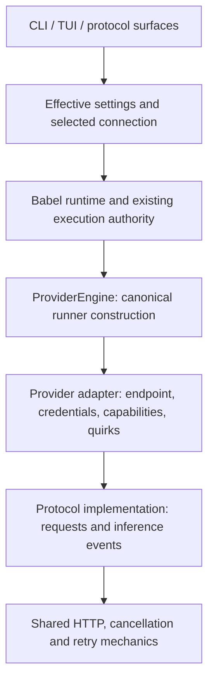

<!-- License: Apache-2.0 - see LICENSE -->
<!-- status: APPROVED - implementation authorized -->
# Babel CLI and provider backend coherence

Design baseline: `c17278b7849558a014692d2a5cbcd2476adb03fb` (main).
Consumer baseline: `babel-harness` 0.2.0.
This is a proposed product design, not contributor policy or evidence of implementation.

## 1. Intent and decisions

Make Babel understandable on a fresh npm installation and make its runtime easier to maintain. A user should understand what Babel does, which project and provider it uses, what it may change, how to change settings, and how to recover from failure.

Owner requirements established in the design discussion:

- Provider-neutral operation, including direct provider credentials rather than a required gateway account.
- Shared inference implementation belongs in files named for its actual protocol or responsibility. Vendor files own only vendor integration details.
- Commands explain their purpose and equivalent operations behave consistently across CLI and TUI.
- Consolidate redundant modes and settings without losing useful capabilities.
- Planning stops before implementation by default. An explicit user preference may enable automatic application and implementation.
- Improve maintainability through fewer implementations and clearly owned contracts.

Proposed engineering calls, subject to approval of this document:

- Refactor incrementally; reuse `ProviderEngine`, existing runner contracts, runtime coordination, and completion authority.
- Offer Work and Plan as primary workflow choices; expose governed execution as thorough review. Preserve `chat` and `deep` as compatibility entry points during migration.
- Change presentation and permissions through separate settings; headless is an output choice.
- Do not select a cloud provider or send inference until the user chooses a connection.
- Provider/model switches affect the current session by default; saving a user or project preference is explicit. Setup saves the initial user default after confirmation.
- Preserve existing dollar/time limits during compatibility migration; setup requires an explicit budget choice, including an explicit unlimited choice. Do not invent a dollar amount.

## 2. Evidence and scope

OBSERVED in the baseline source:

- `deepInfraApi.ts` owns shared compatible inference and OpenRouter-specific campaign behavior. Multiple unrelated providers inherit it.
- Shared transport helpers consume `BABEL_DEEPINFRA_*` settings. `apiFallback.ts` implements Anthropic integration.
- `ProviderEngine` exists, but Chat, critic, and other paths also construct concrete runners.
- Workflow modes, runtime plan/act, approval profiles, operator modes, and simulation overlap.
- CLI registration, argument rewriting, help, completion, and slash dispatch have independently maintained command knowledge.
- Ordinary Chat uses its built-in behavioral contract plus compiled project instructions; it does not load every prompt-library layer.

VERIFIED by isolated consumer probes, without live inference:

- Clean startup selects DeepSeek Flash through OpenRouter and displays READY without a configured key.
- A missing key can produce an Unknown failure summary; a mocked 401 produces generic Retry guidance and a DeepInfra error prefix for an OpenRouter request.
- `exec --help`, `daemon --help`, and `goal --help` display `run` help.
- `/mode plan` stores `mode: chat` with `operatorMode: hard_plan`.
- `auto-edit` and `full-auto` map to the same act/dry-run values.
- Ollama inherits a 120-second timeout and four retries despite different defaults described in its source header.
- A project Plan default merged into an already initialized Chat state remains Chat.

No live provider compatibility, provider task quality, full terminal matrix, or performance improvement is established by those probes.

In scope: installed CLI/TUI onboarding, command contracts, workflow settings, provider construction, shared transport, direct provider adapters, auxiliary inference, settings migration, and consumer artifact qualification. Desktop/protocol consumers must remain compatible with changed shared contracts.

Out of scope: replacing completion authority, rewriting the prompt library, a new extension marketplace, unrelated desktop redesign, publication/deployment, or changing credentials in the maintainer environment.

## 3. Approaches

| Approach | Benefit | Cost / reason |
| --- | --- | --- |
| Incremental extraction using existing contracts (recommended) | Preserves known behavior and permits small, independently qualified changes | Requires a bounded compatibility period and removal of replaced paths |
| Replace inference with a broad provider SDK | Reuses vendor protocol implementations | Requires requalification of cancellation, exact request accounting, tool events, authority, and dependency behavior |
| Rewrite CLI and runtime together | Allows unrestricted redesign | Discards useful contracts and makes regressions harder to localize; rejected for this objective |

Incremental extraction follows the owner's requested shared-code/provider-code separation. A later SDK experiment needs evidence that it reduces maintenance while preserving Babel's documented execution contracts; it is not a prerequisite.

External precedent: AI SDK separates an [OpenAI-compatible implementation](https://github.com/vercel/ai/tree/main/packages/openai-compatible) from a [DeepInfra adapter](https://github.com/vercel/ai/blob/main/packages/deepinfra/src/deepinfra-chat-language-model.ts). [OpenCode provider documentation](https://opencode.ai/docs/providers/#custom-provider) distinguishes compatible Chat Completions endpoints from Responses endpoints. These are examples, not a requirement to adopt their dependencies.

## 4. Architecture and ownership

Responsibilities and initial change owners:

| Responsibility | Existing owners / proposed destination |
| --- | --- |
| Inference contract | `babel-cli/src/runners/base.ts`; extend the existing contract, rather than adding a parallel event vocabulary |
| Runner construction | `runners/providerEngine.ts`; migrate Chat, critic, compaction and pipeline callers to it |
| Compatible protocol | Extract shared code from `runners/deepInfraApi.ts` into `runners/protocol/openai-chat-completions.ts` |
| HTTP mechanics | Reuse/extract `providerResponsePolicy.ts` and stream helpers under a transport owner; retain prepared-request admission and accounting |
| Provider adapters | Thin `runners/provider/` modules, including DeepInfra, OpenRouter, OpenAI, Anthropic, Gemini and local/custom connections |
| Connection/capability metadata | Evolve `providerRegistry.ts`, credential hub and model policy; distinguish provider identity, connection identity and model identity |
| Effective settings | One typed resolver under `src/config/`; replace divergent session/project merging at callers |
| Commands | One application command definition source with CLI and slash projections; retain Commander for parsing |
| User presentation | Existing onboarding, status, failure presentation and renderer paths consume those shared facts |

Extract by actual responsibility, not by a target file count. Do not create empty adapter layers or duplicate existing neutral helpers. A small vendor adapter may configure a shared implementation; no unrelated adapter inherits a vendor-named class.

The shared protocol must not import benchmark campaign policy or decide provider/model fallback. Move provider-specific request transformations to their adapter and inject caller-owned campaign constraints before preparation/serialization. Preserve admission, exact body digests, budget settlement, retries and cancellation; moving checks must not remove them.

## 5. Provider and model contract

A connection is a user-configured provider account/endpoint; a protocol describes how inference is encoded. Two connections may use the same provider with different accounts or deployments.

The resolved selection contains connection ID, provider ID, protocol ID, endpoint identity, exact requested model, credential reference, effective capabilities, and source of each selection. It never exposes credential values in settings/status/events.

- Generic compatible connections accept an explicit base URL and model ID, alongside protocol selection. Known vendors have named adapters for their real differences.
- Native integrations cover OpenAI, Gemini and Anthropic, plus the existing production provider families. Custom protocols use an adapter extension contract. Supporting all providers means extensibility and honest capability reporting, not claiming every model implements every operation.
- Provider/model capability records distinguish supported, unsupported and unknown. Remove provider guesses based on model-name substrings.
- The model picker lists models applicable to the selected connection and operation. Discovery failure permits manual exact model entry; it must not trigger a provider substitution.
- No automatic cross-provider fallback. An explicitly configured fallback names its connection/model and spending scope, is displayed, and receives the same admission checks.
- Tool execution remains in Babel. Provider adapters emit inference/tool requests; they cannot execute tools or grant themselves authority.
- Compaction, review and child inference inherit the selected connection/model unless the user explicitly configures a separate role route. Remove ambient provider guesses and avoid duplicate route resolution.
- Record requested, sent and observed model identity separately. Validate documented aliases using declared resolution rules; do not label an unobserved response identity as verified.
- Retryable transport/429/5xx failures have bounded retries. Missing/invalid credentials, unsupported capabilities, cancellation and exhausted budgets do not retry identically. Zero retries must be expressible.
- Prices and usage may be unknown. A compatible/local-looking endpoint is not proof of free inference.

Provider availability follows completion of deterministic conformance tests. Live connectivity and model/task quality are distinct evidence. Live qualification uses an explicitly authorized account, exact route and spending budget; never ambient maintainer credentials.

## 6. Workflow and permission contract

Keep four separate concepts:

1. Workflow: Work or Plan.
2. Review: standard or thorough (the current governed Deep behavior, including its gates).
3. Permissions: ask, allow in-scope edits, or allow in-scope approved actions.
4. Environment/output: sandbox profile, simulation flag and interactive/headless output.

Work answers questions or performs requested changes within the granted scope. Plan is read-only during plan production. Thorough review does not grant extra permissions or silently select another provider.

`plans.autoApply` defaults to false. Only explicit trusted user configuration may enable it, optionally scoped to a project in the private user configuration. Display its effective value and source before a plan starts. Explicit plan-only intent overrides it. A transition to implementation binds the selected plan, project identity and current permissions, rechecks scope/freshness, and never overrides a denial, budget, failed prerequisite or higher-priority read-only restriction. Plan production and implementation remain distinct recorded stages.

Unify `hard_plan`, runtime plan/act and approval-profile mappings into one effective permission decision. Preserve simulation as an explicit advanced flag because simulated writes differ from read-only planning. Remove user-facing yolo/accept-edits distinctions unless their retained equivalents enforce different, tested policies. Keep sandbox/environment profiles separate; changing a workflow cannot disable isolation.

Public workflow proposal: `work`, `plan`, and `work --review thorough`. During migration, `chat` delegates to Work and `deep` to governed thorough Work. Keep internal mode IDs until normative architecture/ADR/conformance updates and surface parity are complete; presentation consolidation does not authorize deletion of a runtime controller.

## 7. Commands and settings

Use `babel-agent` consistently in installed help and examples. Retain `babel-harness` as the package executable alias. Generate the command recognition set, help and completion from actual command definitions; unknown tokens must not turn a registered command into task prose.

Proposed canonical commands and equivalent slash operations:

| Intent | CLI | TUI |
| --- | --- | --- |
| Guided setup | `babel-agent setup` | `/setup` |
| Connections | `babel-agent provider list/connect/use/status` | `/provider list/connect/use/status` |
| Model choice | `babel-agent model list/use/show` | `/model list/use/show` |
| Effective settings | `babel-agent settings show/set` | `/settings show/set` |
| Workflow | `babel-agent work` or `plan` | `/mode work` or `/mode plan` |
| Apply selected plan | `babel-agent apply --plan <id>` | `/apply <id>` |
| Conversation recovery | `babel-agent session list/resume` | `/session list/resume` |
| Execution recovery | `babel-agent run resume <id>` | `/run resume <id>` |
| File recovery | `babel-agent checkpoint list/restore` | `/checkpoint list/restore` |
| State and usage | `babel-agent status` and `stats` | `/status` and `/stats` |
| Diagnosis | `babel-agent doctor` | `/doctor` |

One help page explains current project, connection/model, capabilities, permissions, budget, instructions and scope. Keep detailed evidence under inspection subcommands. Consolidate overlapping dashboard/cost views behind status/stats; retain aliases where behavior is truly equivalent. Separate display clearing, new conversation and context compaction; do not use compact to mean renderer density. A history view must identify command history versus conversation history.

Settings precedence for non-secret values: explicit invocation flags, session selection, explicit process environment, trusted user-owned project overrides, user defaults, built-in defaults. Show value/source/scope and distinguish saved defaults from session overrides. Credentials have their own resolution contract and must match the chosen connection; an untrusted repository cannot choose a credential destination.

Switching model/provider invalidates the old engine selection atomically and revalidates capabilities. Saving a project setting validates it before writing and applies all supported settings consistently. Do not persist an invalid model or claim a saved Plan default was applied when Chat still won.

## 8. First-run and failure flow

On a fresh profile, explain: "Babel is a coding agent that can inspect your project, make requested changes, and verify the result using the model provider you choose."

Guide the user through connection, credential source, model, permissions/budget, and execution prerequisites. Reuse existing environment credentials by presence only; never display values. Accept masked entry through the established private credential mechanism; no key arguments or secrets in project settings. Make validation requests explicit, describe possible provider charges, and avoid automatic inference during startup or help.

Persist setup progress independently of command history. Interrupted setup resumes; changing directories does not reset account setup. Existing users receive a migration summary without overwriting their configuration. Read-only help and inspection remain available when setup is incomplete.

Use distinct states: setup required, configured/unverified, connected with last-check time, ready for the requested operation, and action required. Do not use READY to mean merely that input is accepted. A successful authentication check is not evidence that tools or the sandbox work.

Check local credential/capability prerequisites before indexing and model preparation. Guide users through Docker/image prerequisites for sandboxed commands; never silently fall back to host execution. Orientation/help that does not need sandboxed commands stays usable.

Present one actionable failure summary with real provider, requested model, error category, retryability and a useful next command. Details are expandable/private diagnostics. Missing key, 401, quota, 429, unsupported model, unavailable sandbox, cancellation and unknown failure have distinct messages. Diagnostic streams must not write into the composer.

## 9. Defaults and instructions inventory

Create one documented, machine-readable inventory generated from the effective settings and runtime policy: workflow, review, permissions, sandbox, provider/model, role routes, budget, deadlines, retry limits, context/compaction limits, task-class limits, indexing, memory persistence, diagnostics/tracing and instruction sources. Show requested and effective values when task class or provider capability changes a limit.

Preserve remote tracing as opt-in. Explain local persistence and where diagnostics can be found without exposing private content. Do not equate model context capacity with current request usage or cumulative session tokens.

Preserve the canonical Chat instruction compiler and existing Deep stack assembly. Expose which built-in and project instructions were included or omitted and why. Setup/help must not imply that every prompt-library layer is active. No new system-prompt copy in a transport module.

## 10. Migration and compatibility

- Internal extraction keeps compatibility exports until known imports, tests, package entry points and consumers migrate. Renames cannot change wire bodies or serialized event identities accidentally.
- Introduce neutral transport settings with explicit precedence over legacy settings. Retain legacy names through at least one documented transition release and report their source in settings/doctor. Do not silently change timeout/retry/token defaults while renaming them.
- Preserve existing saved mode IDs/settings through versioned, idempotent migration. Preserve unknown fields and original configuration for recovery; report ambiguous mappings rather than guessing.
- Existing resume/apply/continue commands can cause effects. Never reinterpret an ambiguous old invocation as plan application. Add canonical namespaces first; legacy forms retain their old contract with guidance until the documented breaking release.
- Keep JSON schemas/events stable or version them explicitly. Human-facing command improvements do not justify silently changing automation output.
- Fix known consumer defects in focused slices, with reproducible before/after evidence. No permanent parallel command registry, provider factory or permission resolver after cutover.

## 11. Delivery slices and acceptance

This is one program with dependent deliverables. After design approval, create separate implementation plans so each can ship and be reviewed independently.

| Slice | Deliverable | Acceptance / owners |
| --- | --- | --- |
| 1. Shared inference | Neutral protocol extraction; thin vendor adapters; canonical construction for existing provider behavior | DeepInfra/OpenRouter/Ollama/Command Code/OpenCode retain request, streaming, retry, cancellation and usage contracts. Migrate caller routes, critics and compaction. Existing failure attribution becomes provider-correct. Owners: runners, Chat provider runtime/accounting, execute and model router |
| 2. Commands and policy | Canonical command metadata, effective settings, consistent Plan semantics and compatible aliases | Registered commands reach their handlers. CLI/TUI/provider selection agree. Plan is read-only by default; auto-apply is explicit and bounded. Owners: cli/argv, commands, interactive dispatch/config/session, config settings, runtime/executor contracts |
| 3. Installed setup | Resumable setup and readiness, honest model/status display, prerequisite guidance and failure recovery | Empty-profile npm user reaches the correct connection/model flow; missing key/401 never become Ready or generic Retry/Unknown. Existing-user migration preserves state. Owners: onboarding, installedDoctor, runtime paths, credential hub, presentation |
| 4. Provider breadth and release qualification | Complete direct OpenAI/Gemini/Anthropic coding contracts plus custom connection support; qualify all retained routes | Every enabled operation passes deterministic conformance and consumer flows; explicit live evidence is separately recorded where available. Owners: native adapters, registry, capabilities, model policy, consumer artifact verification |

Fixing provider breadth is not complete when a key can be saved. Require message/tool round trips, streamed events, system instruction preservation, cancellation, usage/unknown cost, errors, and admitted tool execution. Unsupported operations remain visible and disabled with a reason.

Required behavioral coverage includes: two accounts for one provider; the same model name on different providers; custom endpoints; direct credentials without a gateway key; invalid key/quota/429; unavailable model listing; zero retries; interrupted setup; spaces/non-ASCII paths; local/global executable mismatch; project retargeting; model change mid-session; resume after migration; Plan-to-apply scope changes; and terminal resize/cancellation recovery.

Reuse existing unit suites and `test:consumer-artifact`; extend their real entry-point checks rather than introducing another smoke framework. Relevant existing owners include `argv.test.ts`, `providerEngine.test.ts`, provider API tests, `providerFaultTable.test.ts`, `authorityConformance.test.ts`, `planExecuteMode.test.ts`, `onboarding.test.ts`, `replLifecycle.test.ts` and `chatPreparationParity.test.ts`.

Implementation checks include focused regression suites, package build/typecheck, architectural budgets, consumer archive tests, and the repository's publication/independent-review gates. Preserve harness-v1 authority; update its ADR/conformance artifacts before changing normative mode semantics. Release qualification includes Windows TTY and supported non-TTY output, with narrow/standard/wide terminal evidence. Mocked success is not live qualification.

## 12. Maintenance and completion criteria

- One runner factory for supported inference and auxiliary roles; one effective settings resolver; one command definition source.
- Zero unrelated providers inheriting a vendor-named implementation; no vendor-specific environment names controlling unrelated transports after compatibility retirement.
- No provider inference from model substrings and no silent provider changes.
- Each retained workflow/permission choice has a distinct behavioral test and one owner.
- Generated/help-visible defaults match actual runtime defaults; settings show their source.
- Adding a compatible provider requires configuration or a thin adapter plus conformance fixtures, not edits to multiple agent loops.
- Each slice removes its obsolete path after consumer migration; rollback restores the preceding configuration/schema without deleting sessions or credentials.
- Compare cold help/startup and first useful interaction on equivalent fixtures before/after; make no speedup claim without measurement.

Decisions for owner review: the proposed Work/Plan plus thorough-review presentation; the explicit saved auto-apply rule; session-default switching and explicit saved scopes; and the four-slice migration order. Exact implementation file splits and incidental UI layout are left to the builder within these contracts.
